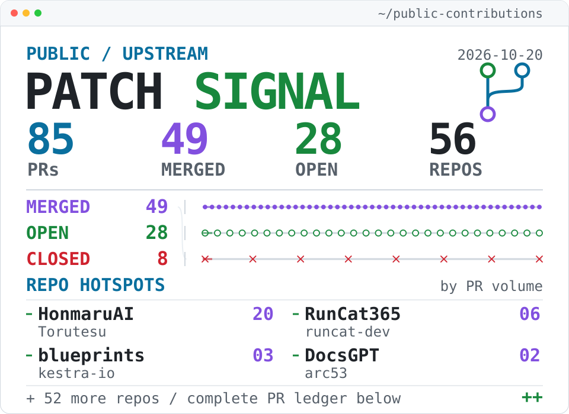

<!-- SPDX-License-Identifier: LicenseRef-All-Rights-Reserved -->

<picture><source media="(prefers-color-scheme: dark)" srcset="https://raw.githubusercontent.com/Anandb71/Anandb71/output/neofetch-dark.svg"><source media="(prefers-color-scheme: light)" srcset="https://raw.githubusercontent.com/Anandb71/Anandb71/output/neofetch-light.svg"></picture>

<a href="https://www.getarbor.dev/"><picture><source media="(prefers-color-scheme: dark)" srcset="https://raw.githubusercontent.com/Anandb71/Anandb71/output/link-arbor-dark.svg"><source media="(prefers-color-scheme: light)" srcset="https://raw.githubusercontent.com/Anandb71/Anandb71/output/link-arbor-light.svg"></picture></a> <a href="https://anandb71.in"><picture><source media="(prefers-color-scheme: dark)" srcset="https://raw.githubusercontent.com/Anandb71/Anandb71/output/link-web-dark.svg"><source media="(prefers-color-scheme: light)" srcset="https://raw.githubusercontent.com/Anandb71/Anandb71/output/link-web-light.svg"></picture></a> <a href="https://www.linkedin.com/in/anandb71/"><picture><source media="(prefers-color-scheme: dark)" srcset="https://raw.githubusercontent.com/Anandb71/Anandb71/output/link-linkedin-dark.svg"><source media="(prefers-color-scheme: light)" srcset="https://raw.githubusercontent.com/Anandb71/Anandb71/output/link-linkedin-light.svg"></picture></a> <a href="https://x.com/anandb711"><picture><source media="(prefers-color-scheme: dark)" srcset="https://raw.githubusercontent.com/Anandb71/Anandb71/output/link-x-dark.svg"><source media="(prefers-color-scheme: light)" srcset="https://raw.githubusercontent.com/Anandb71/Anandb71/output/link-x-light.svg"></picture></a> <a href="mailto:anandbiju71@gmail.com"><picture><source media="(prefers-color-scheme: dark)" srcset="https://raw.githubusercontent.com/Anandb71/Anandb71/output/link-email-dark.svg"><source media="(prefers-color-scheme: light)" srcset="https://raw.githubusercontent.com/Anandb71/Anandb71/output/link-email-light.svg"></picture></a>

<!-- CONTRIBUTIONS:START -->

## Open source & public contributions

<picture><source media="(prefers-color-scheme: dark)" srcset="assets/oss/oss-dark.svg"><source media="(prefers-color-scheme: light)" srcset="assets/oss/oss-light.svg"></picture>

**Find the edge case. Write the regression test. Send the patch.**

85 PRs across 56 public repositories, from database internals and supply-chain security to developer tools, video, maps, and AI. OSS projects and public collaborations; personal and Arbor repositories excluded.

### Recently merged

<table>
<tr>
<td width="50%" valign="top">DATABASE INTERNALS  <strong>vitessio/vitess</strong> Keep schema diffs unchanged while applying table changes.  <a href="https://github.com/vitessio/vitess/pull/21424">↗ PR #21424</a> &nbsp; MERGED · 2026-10-20</td>
<td width="50%" valign="top">WORKFLOW FORENSICS  <strong>kestra-io/blueprints</strong> Bisect a failed S3 batch into a verified one-record reproducer.  <a href="https://github.com/kestra-io/blueprints/pull/4359">↗ PR #4359</a> &nbsp; MERGED · 2026-10-20</td>
</tr>
<tr>
<td width="50%" valign="top">OPERATIONAL SAFETY  <strong>privacyidea/privacyidea</strong> Return HTTP 503 when the HSM is not ready.  <a href="https://github.com/privacyidea/privacyidea/pull/6084">↗ PR #6084</a> &nbsp; MERGED · 2026-10-19</td>
<td width="50%" valign="top">PLAYBACK THAT RESPONDS  <strong>videojs/video.js</strong> Update the video frame while dragging the seek slider.  <a href="https://github.com/videojs/video.js/pull/9510">↗ PR #9510</a> &nbsp; MERGED · 2026-10-15</td>
</tr>
<tr>
<td width="50%" valign="top">MAPS, WITHOUT THE EDGE CASE  <strong>maplibre/maplibre-gl-js</strong> Recognize .cjs worker URLs with a query or fragment.  <a href="https://github.com/maplibre/maplibre-gl-js/pull/8773">↗ PR #8773</a> &nbsp; MERGED · 2026-10-15</td>
<td width="50%" valign="top">LESS NOISY TOOLING  <strong>pylint-dev/pylint</strong> Fix a used-before-assignment false positive for lambda parameters.  <a href="https://github.com/pylint-dev/pylint/pull/11577">↗ PR #11577</a> &nbsp; MERGED · 2026-10-08</td>
</tr>
</table>

### The complete patch log

🟣 **49 merged** &nbsp; 🟢 **28 open** &nbsp; ⚪ **8 closed without merge**

<strong>All 85 pull requests · 56 repositories</strong> — expand the full ledger

All-time public PR history, ordered by each repository's latest contribution. Statuses checked 20 Oct 2026.

#### [kestra-io/plugin-solace](https://github.com/kestra-io/plugin-solace)

- 🟢 Open · [#171](https://github.com/kestra-io/plugin-solace/pull/171) · fix(trigger): generate execution via TriggerService

#### [kestra-io/blueprints](https://github.com/kestra-io/blueprints)

- 🟣 Merged · [#4359](https://github.com/kestra-io/blueprints/pull/4359) · feat(blueprints): add failed S3 batch bisection to a verified one-record reproducer
- 🟣 Merged · [#3184](https://github.com/kestra-io/blueprints/pull/3184) · Drone Mission Go/No-Go Gate with NOAA Space Weather, Open-Meteo and DuckDB
- 🟣 Merged · [#2892](https://github.com/kestra-io/blueprints/pull/2892) · feat(blueprints): add MCP server supply-chain audit with OSV, MCP Registry and DuckDB

#### [kestra-io/plugin-googleworkspace](https://github.com/kestra-io/plugin-googleworkspace)

- 🟢 Open · [#447](https://github.com/kestra-io/plugin-googleworkspace/pull/447) · fix(drive): honor includeSubfolders in FileCreatedTrigger

#### [in-toto/witness](https://github.com/in-toto/witness)

- 🟢 Open · [#827](https://github.com/in-toto/witness/pull/827) · docs: render the completion command in the CLI reference

#### [theupdateframework/python-tuf](https://github.com/theupdateframework/python-tuf)

- 🟢 Open · [#3034](https://github.com/theupdateframework/python-tuf/pull/3034) · Metadata API: Reject non-canonical bin names in SuccinctRoles

#### [in-toto/in-toto-rs](https://github.com/in-toto/in-toto-rs)

- 🟢 Open · [#125](https://github.com/in-toto/in-toto-rs/pull/125) · Return an error instead of panicking on malformed ECDSA PKCS#8 keys

#### [theupdateframework/go-tuf](https://github.com/theupdateframework/go-tuf)

- 🟢 Open · [#800](https://github.com/theupdateframework/go-tuf/pull/800) · multirepo: refresh every repository even when one fails

#### [arc53/DocsGPT](https://github.com/arc53/DocsGPT)

- 🟢 Open · [#3115](https://github.com/arc53/DocsGPT/pull/3115) · fix(parser): strip only real HTML tags and comments in MarkdownParser
- 🟢 Open · [#3114](https://github.com/arc53/DocsGPT/pull/3114) · fix(parser): ignore # lines inside fenced code blocks in MarkdownParser

#### [kestra-io/plugin-snmp](https://github.com/kestra-io/plugin-snmp)

- 🟣 Merged · [#73](https://github.com/kestra-io/plugin-snmp/pull/73) · fix(snmp): use snmpVersion in SendInform example

#### [kestra-io/plugin-meta](https://github.com/kestra-io/plugin-meta)

- 🟣 Merged · [#80](https://github.com/kestra-io/plugin-meta/pull/80) · fix(facebook): send datePreset in GetInsights when since/until are unset

#### [kestra-io/plugin-linkedin](https://github.com/kestra-io/plugin-linkedin)

- 🟣 Merged · [#76](https://github.com/kestra-io/plugin-linkedin/pull/76) · fix(linkedin): use configured apiVersion for LinkedIn-Version header in GetPostAnalytics

#### [videojs/video.js](https://github.com/videojs/video.js)

- 🟣 Merged · [#9510](https://github.com/videojs/video.js/pull/9510) · fix(packages): seek while dragging the time slider so the frame updates

#### [LargeModGames/spotatui](https://github.com/LargeModGames/spotatui)

- 🟣 Merged · [#837](https://github.com/LargeModGames/spotatui/pull/837) · fix(stats): say "1 play", "1 track hit" and "1 track" for a count of one

#### [maplibre/maplibre-gl-js](https://github.com/maplibre/maplibre-gl-js)

- 🟣 Merged · [#8773](https://github.com/maplibre/maplibre-gl-js/pull/8773) · fix(worker): treat .cjs fragment/query as classic worker URL

#### [pylint-dev/pylint](https://github.com/pylint-dev/pylint)

- 🟢 Open · [#11662](https://github.com/pylint-dev/pylint/pull/11662) · Fix false negative for modified-iterating-list on uninferable lists
- 🟣 Merged · [#11577](https://github.com/pylint-dev/pylint/pull/11577) · Fix used-before-assignment false positive for lambda parameters (#9126)

#### [tursodatabase/turso](https://github.com/tursodatabase/turso)

- 🟢 Open · [#9874](https://github.com/tursodatabase/turso/pull/9874) · core/translate: sort ORDER BY expressions over a column as BINARY

#### [career-ops-hq/career-ops](https://github.com/career-ops-hq/career-ops)

- 🟣 Merged · [#5238](https://github.com/career-ops-hq/career-ops/pull/5238) · refactor(tracker): share failUsage between set-status and mark-pdf-ready

#### [compiler-explorer/compiler-explorer](https://github.com/compiler-explorer/compiler-explorer)

- 🟣 Merged · [#9273](https://github.com/compiler-explorer/compiler-explorer/pull/9273) · Fix #9272: list GnuCOBOL 1.1 -std dialects individually

#### [coreruleset/coreruleset](https://github.com/coreruleset/coreruleset)

- 🟢 Open · [#4862](https://github.com/coreruleset/coreruleset/pull/4862) · fix(901370): only allow +json subtypes that 920470 accepts

#### [fastmachinelearning/hls4ml](https://github.com/fastmachinelearning/hls4ml)

- 🟢 Open · [#1581](https://github.com/fastmachinelearning/hls4ml/pull/1581) · Remove RecurrentReuseFactor from the Altera backend

#### [twbs/bootstrap](https://github.com/twbs/bootstrap)

- 🟢 Open · [#43077](https://github.com/twbs/bootstrap/pull/43077) · Stop Escape from closing a dialog when `keyboard` is false

#### [open-wanderer/wanderer](https://github.com/open-wanderer/wanderer)

- ⚪ Closed, unmerged · [#1374](https://github.com/open-wanderer/wanderer/pull/1374) · fix(federation): retract trails and lists that are set back to private

#### [freedomofpress/securedrop](https://github.com/freedomofpress/securedrop)

- 🟢 Open · [#7954](https://github.com/freedomofpress/securedrop/pull/7954) · Suppress OSSEC alerts for Tor circuit build expiry summaries

#### [kornia/kornia](https://github.com/kornia/kornia)

- 🟣 Merged · [#5917](https://github.com/kornia/kornia/pull/5917) · fix(augmentation): validate RandomMosaic padding_mode at construction

#### [EvoScientist/EvoScientist](https://github.com/EvoScientist/EvoScientist)

- ⚪ Closed, unmerged · [#632](https://github.com/EvoScientist/EvoScientist/pull/632) · fix(cli): fingerprint the server-loaded config for drift checks

#### [scalar/scalar](https://github.com/scalar/scalar)

- 🟣 Merged · [#10544](https://github.com/scalar/scalar/pull/10544) · fix(workspace-store): match cookie paths on a path boundary

#### [moeru-ai/airi](https://github.com/moeru-ai/airi)

- ⚪ Closed, unmerged · [#2845](https://github.com/moeru-ai/airi/pull/2845) · test(stage-ui): pin the clock in sessions drawer time label tests

#### [privacyidea/privacyidea](https://github.com/privacyidea/privacyidea)

- 🟣 Merged · [#6084](https://github.com/privacyidea/privacyidea/pull/6084) · Return 503 from readyz when the HSM is not ready

#### [benbalter/wordpress-static-site-exporter](https://github.com/benbalter/wordpress-static-site-exporter)

- 🟣 Merged · [#459](https://github.com/benbalter/wordpress-static-site-exporter/pull/459) · Fire jekyll_export_complete when an export finishes

#### [ulyssa/iamb](https://github.com/ulyssa/iamb)

- 🟣 Merged · [#789](https://github.com/ulyssa/iamb/pull/789) · Allow configuring the date and time formats

#### [Ericsson/codechecker](https://github.com/Ericsson/codechecker)

- 🟣 Merged · [#5132](https://github.com/Ericsson/codechecker/pull/5132) · [fix] Import declarative_base from sqlalchemy.orm

#### [erebe/wstunnel](https://github.com/erebe/wstunnel)

- ⚪ Closed, unmerged · [#556](https://github.com/erebe/wstunnel/pull/556) · fix(http-proxy): answer failed CONNECT auth with 407 and a challenge

#### [vitessio/vitess](https://github.com/vitessio/vitess)

- 🟣 Merged · [#21424](https://github.com/vitessio/vitess/pull/21424) · schemadiff: leave the diff unchanged in CreateTableEntity.Apply()

#### [django-oauth/django-oauth-toolkit](https://github.com/django-oauth/django-oauth-toolkit)

- 🟢 Open · [#1929](https://github.com/django-oauth/django-oauth-toolkit/pull/1929) · fix(authorization-server): validate redirect_uri before consent error redirects

#### [ludo-technologies/pyscn](https://github.com/ludo-technologies/pyscn)

- 🟣 Merged · [#836](https://github.com/ludo-technologies/pyscn/pull/836) · fix(lcom): leave isolated stateless methods out of LCOM4

#### [patroni/patroni](https://github.com/patroni/patroni)

- 🟢 Open · [#3745](https://github.com/patroni/patroni/pull/3745) · Apply etcd credentials from the environment on their own

#### [project-copacetic/copacetic](https://github.com/project-copacetic/copacetic)

- 🟢 Open · [#1733](https://github.com/project-copacetic/copacetic/pull/1733) · fix: write one VEX document covering every patched platform

#### [oapi-codegen/oapi-codegen](https://github.com/oapi-codegen/oapi-codegen)

- 🟢 Open · [#2598](https://github.com/oapi-codegen/oapi-codegen/pull/2598) · feat(client): render `x-stability-level` in client Godoc

#### [checkmake/checkmake](https://github.com/checkmake/checkmake)

- 🟢 Open · [#289](https://github.com/checkmake/checkmake/pull/289) · Don't parse target-specific variable assignments as rules

#### [PyCQA/flake8-bugbear](https://github.com/PyCQA/flake8-bugbear)

- 🟣 Merged · [#585](https://github.com/PyCQA/flake8-bugbear/pull/585) · B031: don't flag a bare groupby() the module binds to something else

#### [go-mysql-org/go-mysql](https://github.com/go-mysql-org/go-mysql)

- 🟣 Merged · [#1199](https://github.com/go-mysql-org/go-mysql/pull/1199) · server: keep MyError code when writeError gets a wrapped error

#### [go-critic/go-critic](https://github.com/go-critic/go-critic)

- 🟢 Open · [#1545](https://github.com/go-critic/go-critic/pull/1545) · checkers/unnamedResult: fix inverted checkExported param

#### [chainguard-dev/apko](https://github.com/chainguard-dev/apko)

- 🟢 Open · [#2545](https://github.com/chainguard-dev/apko/pull/2545) · fix(build): avoid data race on layer compression-cache hit

#### [open-policy-agent/opa](https://github.com/open-policy-agent/opa)

- 🟢 Open · [#9324](https://github.com/open-policy-agent/opa/pull/9324) · topdown: deny unix:// http.send when allow_net is set

#### [anchore/syft](https://github.com/anchore/syft)

- 🟢 Open · [#5374](https://github.com/anchore/syft/pull/5374) · Fix CPE vendor for Debian-native packages like dpkg and apt

#### [DefectDojo/django-DefectDojo](https://github.com/DefectDojo/django-DefectDojo)

- 🟢 Open · [#16189](https://github.com/DefectDojo/django-DefectDojo/pull/16189) · Add missing modern regulations to regulation fixture (#14508)

#### [charmbracelet/bubbletea](https://github.com/charmbracelet/bubbletea)

- 🟢 Open · [#1839](https://github.com/charmbracelet/bubbletea/pull/1839) · fix(renderer): restore DECST8C tab stops after resize

#### [ossf/scorecard](https://github.com/ossf/scorecard)

- 🟢 Open · [#5286](https://github.com/ossf/scorecard/pull/5286) · :bug: Fix line numbers for inline run steps in workflows

#### [Torutesu/HonmaruAI](https://github.com/Torutesu/HonmaruAI)

- 🟣 Merged · [#169](https://github.com/Torutesu/HonmaruAI/pull/169) · Typing indicator in conversations and threads
- 🟣 Merged · [#168](https://github.com/Torutesu/HonmaruAI/pull/168) · Sidebar categories: folded sections keep what needs you, and folds persist
- 🟣 Merged · [#167](https://github.com/Torutesu/HonmaruAI/pull/167) · Play video and audio in the message (with HTTP Range on the file route)
- 🟣 Merged · [#166](https://github.com/Torutesu/HonmaruAI/pull/166) · Emoji picker: search, recents, Unicode shortcodes, big emoji
- 🟣 Merged · [#165](https://github.com/Torutesu/HonmaruAI/pull/165) · Message keyboard shortcuts and an in-app delete confirmation
- 🟣 Merged · [#164](https://github.com/Torutesu/HonmaruAI/pull/164) · Keyboard navigation that follows the screen, and platform-correct shortcuts
- 🟣 Merged · [#163](https://github.com/Torutesu/HonmaruAI/pull/163) · Profile popout on a face, a name or an @mention, with presence dots
- 🟣 Merged · [#162](https://github.com/Torutesu/HonmaruAI/pull/162) · Inline reply: answer a message in the flow, with a quote you can click
- 🟣 Merged · [#159](https://github.com/Torutesu/HonmaruAI/pull/159) · Instant send: messages appear on Enter, the box never locks, nothing is lost
- 🟣 Merged · [#158](https://github.com/Torutesu/HonmaruAI/pull/158) · Reading history: no scroll yank, Jump to present, read means seen, catch-up after reconnect
- 🟣 Merged · [#157](https://github.com/Torutesu/HonmaruAI/pull/157) · Right-click a message for its whole menu, with quick reactions
- 🟣 Merged · [#156](https://github.com/Torutesu/HonmaruAI/pull/156) · Highlight messages that mention you
- 🟣 Merged · [#155](https://github.com/Torutesu/HonmaruAI/pull/155) · History paging no longer stops early after an unsent message
- 🟣 Merged · [#154](https://github.com/Torutesu/HonmaruAI/pull/154) · Status from your avatar: presets, clear-after, away with a delegate
- 🟣 Merged · [#153](https://github.com/Torutesu/HonmaruAI/pull/153) · Appearance: Light/Dark/System theme and a compact message display
- 🟣 Merged · [#152](https://github.com/Torutesu/HonmaruAI/pull/152) · Quick switcher: Ctrl/Cmd+K jumps to any channel, DM, group or agent
- 🟣 Merged · [#151](https://github.com/Torutesu/HonmaruAI/pull/151) · Notifications that work in Chrome and Firefox: prompt, resubscribe, in-tab, badges
- 🟣 Merged · [#150](https://github.com/Torutesu/HonmaruAI/pull/150) · Desktop app: Electron shell with tray, badge, honmaru:// links
- 🟣 Merged · [#149](https://github.com/Torutesu/HonmaruAI/pull/149) · Chat: Discord markdown (spoilers, underline, strike, headings, subtext)
- 🟣 Merged · [#148](https://github.com/Torutesu/HonmaruAI/pull/148) · Agents: up to 5 per message, answering side by side

#### [itsrithikka-sys/Student-Attendance-Management-System](https://github.com/itsrithikka-sys/Student-Attendance-Management-System)

- 🟣 Merged · [#1](https://github.com/itsrithikka-sys/Student-Attendance-Management-System/pull/1) · Fix README naming and run instructions, add missing Update button icon

#### [sachikaiitm/StyleSense-Multimodal-Search](https://github.com/sachikaiitm/StyleSense-Multimodal-Search)

- 🟢 Open · [#1](https://github.com/sachikaiitm/StyleSense-Multimodal-Search/pull/1) · Backend refactor

#### [runcat-dev/RunCat365](https://github.com/runcat-dev/RunCat365)

- 🟣 Merged · [#299](https://github.com/runcat-dev/RunCat365/pull/299) · feat: implement self-made custom runners UI and integration
- 🟣 Merged · [#298](https://github.com/runcat-dev/RunCat365/pull/298) · feat: Add native CPU/GPU thermal zone monitoring (Phase 1)
- 🟣 Merged · [#272](https://github.com/runcat-dev/RunCat365/pull/272) · Add GPU info display in tooltip and menu
- 🟣 Merged · [#271](https://github.com/runcat-dev/RunCat365/pull/271) · Feature/speed source selection
- ⚪ Closed, unmerged · [#264](https://github.com/runcat-dev/RunCat365/pull/264) · Feat: GPU monitoring (Speed + Heat + Tooltip)
- ⚪ Closed, unmerged · [#263](https://github.com/runcat-dev/RunCat365/pull/263) · Modernization (.NET 9) &amp; GPU Monitoring Feature

#### [swiftlang/swift](https://github.com/swiftlang/swift)

- 🟢 Open · [#88019](https://github.com/swiftlang/swift/pull/88019) · [ASTPrinter] Fill missing implicit conversion expr printing (fixes #61601)

#### [pranshuparmar/witr](https://github.com/pranshuparmar/witr)

- 🟣 Merged · [#52](https://github.com/pranshuparmar/witr/pull/52) · feat: resolve docker-proxy IPs to container names

#### [firstcontributions/first-contributions](https://github.com/firstcontributions/first-contributions)

- ⚪ Closed, unmerged · [#108596](https://github.com/firstcontributions/first-contributions/pull/108596) · first contri
- 🟣 Merged · [#108595](https://github.com/firstcontributions/first-contributions/pull/108595) · Add Anandb71 to Contributors list

#### [csivitu/nextjs-frontend-boilerplate](https://github.com/csivitu/nextjs-frontend-boilerplate)

- ⚪ Closed, unmerged · [#65](https://github.com/csivitu/nextjs-frontend-boilerplate/pull/65) · added name

<strong>Beyond the patch · 7 bug reports</strong> — reproductions, root causes, and proposed fixes

Reported issues are tracked separately from the PR totals above.

- 🟢 Open · [kestra-io/plugin-solace #170](https://github.com/kestra-io/plugin-solace/issues/170) · Trigger: execution is built by hand, so it has no tenantId and drops trigger labels
- ⚪ Closed · [kestra-io/plugin-gcp #739](https://github.com/kestra-io/plugin-gcp/issues/739) · HttpFunction ignores maxDuration and hardcodes a 60-second read idle timeout
- 🟢 Open · [kestra-io/plugin-kestra #203](https://github.com/kestra-io/plugin-kestra/issues/203) · FreshnessTrigger examples use checkInterval, which isn't a property, so they fail validation
- 🟢 Open · [theupdateframework/python-tuf #3033](https://github.com/theupdateframework/python-tuf/issues/3033) · Metadata API: SuccinctRoles.is_delegated_role() accepts non-canonical bin names
- 🟢 Open · [arc53/DocsGPT #3113](https://github.com/arc53/DocsGPT/issues/3113) · 🐛 Bug Report: Markdown parser's HTML cleanup deletes text between "&lt;" and "&gt;"
- 🟢 Open · [arc53/DocsGPT #3112](https://github.com/arc53/DocsGPT/issues/3112) · 🐛 Bug Report: Markdown parser treats "#" lines inside fenced code blocks as headings
- 🟢 Open · [kestra-io/plugin-googleworkspace #444](https://github.com/kestra-io/plugin-googleworkspace/issues/444) · drive.FileCreatedTrigger ignores includeSubfolders, so files in subfolders never trigger

Snapshot: 20 Oct 2026 (India). Counts include public PRs authored by <a href="https://github.com/Anandb71">@Anandb71</a> outside Anandb71 and getArbor-dev. Closed means closed without merge. <a href="config/contributions.json">Data</a> · <a href="https://github.com/search?q=author%3AAnandb71+is%3Apr+is%3Apublic+-user%3AAnandb71+-org%3AgetArbor-dev&amp;type=pullrequests">Live PR search ↗</a>

<!-- CONTRIBUTIONS:END -->

<picture><source media="(prefers-color-scheme: dark)" srcset="https://raw.githubusercontent.com/Anandb71/Anandb71/output/work-dark.svg"><source media="(prefers-color-scheme: light)" srcset="https://raw.githubusercontent.com/Anandb71/Anandb71/output/work-light.svg"></picture>

<a href="https://github.com/getArbor-dev/arbor"><picture><source media="(prefers-color-scheme: dark)" srcset="https://raw.githubusercontent.com/Anandb71/Anandb71/output/project-arbor-dark.svg"><source media="(prefers-color-scheme: light)" srcset="https://raw.githubusercontent.com/Anandb71/Anandb71/output/project-arbor-light.svg"></picture></a>
<a href="https://github.com/Anandb71/Bleurs"><picture><source media="(prefers-color-scheme: dark)" srcset="https://raw.githubusercontent.com/Anandb71/Anandb71/output/project-bleurs-dark.svg"><source media="(prefers-color-scheme: light)" srcset="https://raw.githubusercontent.com/Anandb71/Anandb71/output/project-bleurs-light.svg"></picture></a>

<a href="https://github.com/Anandb71/LoRA-jit"><picture><source media="(prefers-color-scheme: dark)" srcset="https://raw.githubusercontent.com/Anandb71/Anandb71/output/project-lora-jit-dark.svg"><source media="(prefers-color-scheme: light)" srcset="https://raw.githubusercontent.com/Anandb71/Anandb71/output/project-lora-jit-light.svg"></picture></a>
<a href="https://github.com/Anandb71/Legion-LOQ-control"><picture><source media="(prefers-color-scheme: dark)" srcset="https://raw.githubusercontent.com/Anandb71/Anandb71/output/project-legion-dark.svg"><source media="(prefers-color-scheme: light)" srcset="https://raw.githubusercontent.com/Anandb71/Anandb71/output/project-legion-light.svg"></picture></a>

